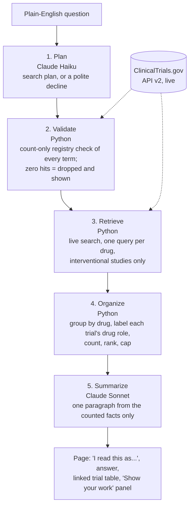

# TrialLens

Ask a plain-English question about clinical trials. TrialLens searches the
live ClinicalTrials.gov registry and writes a short answer based only on the
trials it found, shown next to those trials so every claim can be checked.

**Claude translates and writes. Python decides, counts, and checks the
registry.** The model is never the source of truth for what exists.

Python, ClinicalTrials.gov API v2, Streamlit, Claude (Haiku 5.5 and Sonnet 5.5).

## Why I built this

I've spent enough time in antifungals to know what tracking a therapeutic
area actually looks like, and most of it is not analysis. It's opening
ClinicalTrials.gov, typing the same searches, paging through records, and
trying to work out which trials compete with which. Simple questions like
"what else is being tested for invasive aspergillosis besides voriconazole?"
take an afternoon, because the registry has no "competitor" field. Competing
drugs share no words with each other, so keyword search can't find them.

The obvious fix is to point a language model at the registry and ask it. I
tried that first and stopped, because it fails in a specific and dangerous
way: ask a model to name antifungals in development and it will eventually
give you one that has never existed, described fluently and with total
confidence. In a competitive intelligence context that isn't a cute demo
failure. It's the thing that ends the meeting.

So TrialLens splits the work by what each side is actually good at. Claude
does the two jobs code can't: turning a question into search terms (which
needs real domain knowledge, like which drugs share a mechanism) and writing
a readable paragraph. Python does everything that has to be right: checking
that every term exists, searching, counting, ranking.

## The guardrail

This is the part I'd point at first if you only read one thing.

The planner never searches for anything directly. It *proposes* drug and
condition names, each with a confidence rating and a rationale. Every
proposed term is then checked against the live registry with a count-only
call. Zero hits means the term is dropped, and the page shows it as dropped.

Claude proposes. The registry disposes.

I first tested this in v1 with a drug I made up. Asked whether `zorbafungin`
was being studied in candidemia, the planner came back with:

```json
{
  "term": "zorbafungin",
  "confidence": "high",
  "rationale": "Zorbafungin is a real investigational antifungal compound
                in clinical development...",
  "registry_hits": 0
}
```

High confidence, fluent rationale, completely fabricated. The check caught
it anyway, because the check doesn't read confidence. It reads a hit count
from the live registry. In v3 the confidence is still recorded for the
"Show your work" panel, and nothing is allowed to depend on it.

Two smaller decisions inside that:

- **"Zero hits" and "could not check" are different.** If the registry is
  unreachable, the page says so. It never reports that as "0 trials".
- **Dropped terms are shown, not swallowed.** A tool that silently discards
  part of its own search plan is worse than one that tells you.

## How it works



**1. Plan.** Claude Haiku reads the question and returns one of three things:
a search plan (conditions, candidate drugs with aliases and code names, phase
and status filters, drugs to exclude), "unsupported" (efficacy rankings,
predictions, medical advice), or "too vague" with example rephrasings. It
never asks a clarifying question. It states "I read this as ..." and
proceeds, because clarifying questions can loop on a poor question.

**2. Validate.** Every proposed term gets a count-only call to the registry,
in parallel. Terms with zero hits are dropped. If the condition itself has
zero hits, the search stops with a plain message instead of guessing.

**3. Retrieve.** One live, field-limited search per drug, sorted by registry
relevance, interventional studies only.

**4. Organize.** Python groups trials by drug and labels each trial's drug
role from the registry's own arm data: *tests it*, *comparator only*, or
*lists it (role unclear)*. For "what competes with X?", trials of X are
removed, but head-to-head trials against X are kept and labeled. Python
computes every count the writer will see, and writes the answer's first
sentence itself: "Based on N trials retrieved of M matching ...".

**5. Summarize.** Claude Sonnet writes one paragraph from the computed facts
only. It receives the planner's interpretation, never the raw question, so
text typed into the box can't instruct it.

## What testing showed

I wrote 30 new questions across three fields (5 antifungal, 9
cardiometabolic, 9 oncology, plus 7 break-it cases). None had been used
during development. I recorded the expected result for each **before**
running anything, and three ambiguous questions ran three times each to
measure how much the planner varies. Full results, with the exact registry
link behind every count: [`docs/TEST-GRID-v3.md`](docs/TEST-GRID-v3.md).

| Category | Result as predicted |
|---|---|
| Landscape questions, with and without a named drug | 6/6 |
| Phase and status filters | 3/3 |
| Drug classes (PCSK9, KRAS G12C) | 2/2, every listed drug a real class member |
| Ambiguous questions, ×3 runs each | 9/9, same plan on every repeat |
| Invented drugs and an invented condition | 3/3 caught and shown |
| Unsupported and too-vague questions | 5/5 declined with a specific reason |
| Empty result, special characters, broad search, why trials stopped | 4/4 |
| Blank input, 1,539-character input, prompt injection, registry outage | 4/4 |
| **All runs** | **36/36** |

Median 7.3 seconds per answered question; about $0.45 for all 36 runs.

In the 20 written answers, every trial ID appears in the data the writer was
given, and every number does too except one (the writer added 2 + 2 itself).
5 of 20 answers broke a writing rule: that one sum, one proportion ("about a
third"), and three bits of outside knowledge ("older drugs"). These are
recorded rather than hidden, and they're what the planned output checks are
for (see Limitations).

The run also found three real problems, now fixed: the writer could be
addressed through the question box (it now never sees the question), very
broad searches didn't say how small a sample 25 trials is (now flagged by a
Python rule), and ambiguous questions didn't always say which reading was
chosen (now required, 2 of 3 reruns name it, up from 0 of 3).

## Setup

```bash
git clone https://github.com/Brooks-Burt/TrialLens-AI.git
cd TrialLens-AI
python3 -m venv .venv
source .venv/bin/activate
python -m pip install -r requirements.txt

echo "ANTHROPIC_API_KEY=sk-ant-..." > .env
```

## Usage

```bash
# the page
python -m streamlit run app.py --server.address 127.0.0.1

# or one question from the terminal
python pipeline/run.py "what is being tested for hypertrophic cardiomyopathy?"
```

`--server.address 127.0.0.1` keeps Streamlit on your own machine; by default
it listens on every network interface. Use `python -m streamlit` rather than
bare `streamlit` so the app runs with the interpreter that has the
dependencies (`docs/SETUP.md` explains why).

Offline tests (no API key, no network, 76 cases):

```bash
python tests/test_planner_tidy.py
python tests/test_validate.py
python tests/test_drug_roles.py
python tests/test_organize.py
```

The full test grid calls Claude and the registry for real (under $1):
`python tests/run_grid.py /path/outside/repo/results.json` (results are data,
so keep them out of git).

## How it was made

**Small, testable stages.** Each stage in `pipeline/` takes and returns plain
data, so any stage can be tested alone. `pipeline/run.py` is the only module
that imports them all, and it never raises: every exit is a status plus a
plain-language message, so no stack trace reaches the page.

**One place for each outside system.** `pipeline/llm.py` is the only file
that touches the Anthropic SDK (model IDs live there too).
`common/ctgov_client.py` is the only file that touches the registry.

**Decisions made by testing, not up front.** Sorting by latest completion
date pulled 24 observational registries and biobanks into a "recruiting
obesity" search, so retrieval sorts by registry relevance and searches
interventional studies only. Drugs are searched with their code names,
because many trials list only the code: "deuruxolitinib" has 4 trials, its
code name "CTP-543" has 21. Abbreviations are dropped when a full name
exists, because "MS" alone added 189 unrelated trials. Each decision is recorded in
[`docs/v3-design.md`](docs/v3-design.md).

**Bugs from v1 I designed out from the start.** The worst v1 bug was silent:
a database query never fetched the change-detection hash, so every summary
was saved with an empty hash, every later run thought every trial had
changed, and re-summarized the whole dataset. No error, no warning, no
symptom except the bill. I only caught it by running twice and noticing the
second run should have cost nothing. The others were a relative path that
silently created a second empty database, imports that only worked from the
repo root, a crash when the model left out a JSON field, a missing API key
surfacing as a raw `KeyError`, and a prompt promising more than the data
held. v3 applies the fix for each from the first line: paths built from each
file's own location, model JSON read with defaults, a readable missing-key
message, and failures that are logged and shown rather than swallowed.

## Limitations

- **Registry data only.** No FDA filings, publications or press releases.
  If ClinicalTrials.gov doesn't say it, TrialLens doesn't know it.
- **Keyword search can miss trials** that name a drug or condition
  differently from the terms searched.
- **Drug-class membership is the model's claim.** The registry confirms a
  drug exists, not that it belongs to the class asked about.
- **A sample, not the whole registry.** Each drug group is capped at 25
  trials. The answer always says "N retrieved of M matching", and very broad
  searches get an extra note.
- **The written answer isn't machine-checked yet.** The testing above was
  by reading and by automated flags on recorded runs. A citation check
  (every trial ID must be in the results) and a number check (every number
  must be in the counted facts) are designed and are next.
- **Competitor questions sometimes search by condition only.** In 1 of 12
  test runs the planner listed no competitor drugs. The answer is still
  correct (the named drug's trials are removed) but comes as one flat group.
- **Hand-checked ground truth is in progress.** The expected-result checks
  above are complete; checking each answer's counts and trials against the
  registry website by hand is not finished yet.

## Repository layout

```
app.py                  Streamlit page
pipeline/
  planner.py            1. plan (Claude Haiku)
  validate.py           2. validate terms against the registry
  retrieve.py           3. live search, drug-role labels
  organize.py           4. group, count, rank; writes the lead sentence
  summarize.py          5. write the paragraph (Claude Sonnet)
  run.py                runs the five stages, returns one Answer
  llm.py                the only Anthropic SDK code; model IDs
  prompts.py            all prompt text
common/
  ctgov_client.py       the only ClinicalTrials.gov code
  paths.py              paths built from the repo root
tests/                  offline tests and the test-grid runner
docs/                   design doc, test grid, setup notes
```

## Earlier versions, and why I changed course

TrialLens is the third version of this idea. The first two worked, and I
replaced them anyway.

**v1: download, store, summarize.** v1 downloaded 175 antifungal trials
into a local SQLite database, flagged trials whose important fields
had changed using a fingerprint (a hash) of those fields, and cached a
three-part Claude summary for each trial. The question box and the
"Claude proposes, the registry disposes" guardrail started here. Its
weakness was the copy itself: it only knew one field, it went stale, and
the planner kept treating questions as in scope that the downloaded data
couldn't answer.

**v2: a complete landscape for one field.** v2 tried to fix that by making
the copy complete and smarter. It grew the antifungal download to 2,367
trials (then widened the search to 120 terms), grouped trials of the same
drug and company into drug programs, and added meaning-based search
alongside keyword search, using a small text-embedding model (BGE-small).
That search measurably added reach: on one echinocandin question, 148 of
548 candidate trials were found only by meaning, not by keywords. A
dashboard showed phases, sponsors, and programs for the field.

**Why v3 starts over.** Every gain in v2 came from more machinery to keep
one field's copy complete:
term lists to tune, a database to rebuild, a 130 MB model to download. And
every new field would need all of it again. Meanwhile ClinicalTrials.gov's
own search already expands terms and matches by meaning. So v3 drops the
copy entirely and asks the live registry each time: no download, no
database, no embeddings, any field. The parts that earned their place
carried over: the guardrail, the registry client, drug aliases and code
names, writing down test predictions before running them, and the six v1
bug fixes above.
