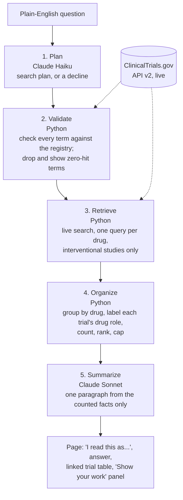

# TrialLens

TrialLens answers plain-English questions about clinical trials using live
data from ClinicalTrials.gov. You get a short written answer and a table of
the trials it's based on, so you can check each claim.

Claude turns the question into search terms and writes the answer. Python
checks those terms against the registry, runs the search, and does all the
counting.

Built with Python, the ClinicalTrials.gov API v2, Streamlit, and Claude
(Haiku 5.5 and Sonnet 5.5).

## Why I built this

I've worked in antifungals, and keeping track of a therapeutic area mostly means
running the same ClinicalTrials.gov searches over and over and working out
which trials compete with which. A question like "what else is being tested
for invasive aspergillosis besides voriconazole?" can take an afternoon. The
registry has no competitor field, and competing drugs don't share names, so
keyword search can't answer it.

A language model knows which drugs compete, but it also makes things up. Ask
one for antifungals in development and sooner or later it will name a drug
that doesn't exist. For competitive intelligence, that's not acceptable.

So the work is split. Claude handles the parts that need language and domain
knowledge: turning a question into drug and condition names, and writing the
answer. Python handles everything that has to be correct: confirming each
name exists, searching, counting, and ranking.

## Checking the model's suggestions

The planner doesn't search directly. It suggests drug and condition names,
and each one is checked against the live registry with a count-only query.
A name with zero matching trials is dropped, and the page shows that it was
dropped.

I tested this in v1 with a drug I made up. Asked about `zorbafungin` in
candidemia, the planner rated it "high" confidence and described it as "a real
investigational antifungal compound in clinical development". The registry
had zero trials for it, so it was dropped. The model's confidence rating is
still shown in the app, but nothing depends on it.

Two related rules:

- If the registry can't be reached, the page says so. It never reports that
  as "0 trials".
- Dropped terms are always shown, so you can see what the search left out.

## How it works



1. **Plan.** Claude Haiku turns the question into conditions, drug names
   (with code names), and phase or status filters. It declines questions the
   registry can't answer, like "which drug works best", and offers example
   rephrasings for questions that are too vague. It doesn't ask clarifying
   questions. It states how it read the question and carries on.
2. **Validate.** Every suggested term is checked against the registry. If the
   condition itself has no trials, the search stops with a clear message.
3. **Retrieve.** One live search per drug, interventional studies only.
4. **Organize.** Python groups trials by drug and labels each drug's role in
   each trial from the registry's arm data: tested, comparator only, or role
   unclear. For "what competes with X?", trials of X are removed, but
   head-to-head trials against X are kept. Python also writes the answer's
   first sentence: "Based on N trials retrieved of M matching ...".
5. **Summarize.** Claude Sonnet writes one paragraph using only the facts
   Python computed. It sees the planner's reading of the question, not the
   raw text, so nothing typed into the box can give it instructions.

## Testing

I wrote 30 new questions across three fields (5 antifungal, 9
cardiometabolic, 9 oncology, plus 7 edge cases) and recorded the expected
result for each before running any of them. Three ambiguous questions were
run three times each to see whether the planner gave the same answer every
time. Full results, with a registry link for every count, are in
[`docs/TEST-GRID-v3.md`](docs/TEST-GRID-v3.md).

| Category | Matched prediction |
|---|---|
| Landscape questions, with and without a named drug | 6/6 |
| Phase and status filters | 3/3 |
| Drug classes (PCSK9, KRAS G12C) | 2/2 |
| Ambiguous questions, 3 runs each | 9/9, same plan every time |
| Made-up drugs and a made-up condition | 3/3 caught |
| Unsupported and too-vague questions | 5/5 declined |
| Empty result, special characters, broad search, why trials stopped | 4/4 |
| Blank input, very long input, prompt injection, registry outage | 4/4 |
| **Total** | **36/36** |

Answered questions took a median of 7.3 seconds. All 36 runs cost about $0.45.

Every trial ID in the 20 written answers came from the data the writer was
given, and so did every number but one, where the writer added two numbers
itself. 5 of the 20 answers broke a writing rule (that sum, one proportion,
and three bits of outside knowledge like "older drugs"). The test run also
turned up three problems, which are now fixed:

- The writer could be addressed through the question box.
- Very broad searches didn't say how small a 25-trial sample is.
- Ambiguous questions didn't always say which reading was chosen.

## Setup

```bash
git clone https://github.com/Brooks-Burt/TrialLens-AI.git
cd TrialLens-AI
python3 -m venv .venv
source .venv/bin/activate
python -m pip install -r requirements.txt
echo "ANTHROPIC_API_KEY=sk-ant-..." > .env
```

Run the app:

```bash
python -m streamlit run app.py --server.address 127.0.0.1
```

Or ask one question from the terminal:

```bash
python pipeline/run.py "what is being tested for hypertrophic cardiomyopathy?"
```

`--server.address 127.0.0.1` keeps the app on your own machine. More setup
notes are in [`docs/SETUP.md`](docs/SETUP.md).

Offline tests (76 cases, no API key or network needed):

```bash
python tests/test_planner_tidy.py
python tests/test_validate.py
python tests/test_drug_roles.py
python tests/test_organize.py
```

`python tests/run_grid.py /path/outside/repo/results.json` reruns the full
test grid against Claude and the live registry (under $1).

## Design notes

- Each stage in `pipeline/` takes and returns plain data, so each can be
  tested on its own. `pipeline/run.py` connects them and turns every failure
  into a plain message instead of an error page.
- `pipeline/llm.py` is the only file that calls Claude, and
  `common/ctgov_client.py` is the only file that calls the registry.
- Some choices came out of testing. Sorting by completion date pulled
  observational registries and biobanks into results, so the search sorts
  by relevance and covers interventional studies only. Drugs are searched
  with their code names, because many trials list only the code
  ("deuruxolitinib" has 4 trials; its code name "CTP-543" has 21). Short
  abbreviations are dropped when a full name exists, because "MS" alone
  added 189 unrelated trials. More detail is in
  [`docs/v3-design.md`](docs/v3-design.md).
- v1 had six bugs, and most of them didn't crash. They quietly gave wrong
  results. The worst saved every summary without its change-tracking hash, so every run
  re-summarized every trial and I paid for it each time. v3 guards against
  all six from the start: file paths that work from any folder, model output
  read with safe defaults, a clear message when the API key is missing, and
  failures that are shown instead of hidden.

## Limitations

- **Registry data only.** No FDA filings, publications, or press releases.
- **Keyword search can miss trials** that use a different name for the drug
  or condition.
- **Drug-class membership comes from the model.** The registry confirms a
  drug exists, not that it belongs to the class you asked about.
- **Results are a sample.** Each drug group is capped at 25 trials, and the
  answer always says how many it saw out of how many matched.
- **Written answers aren't automatically checked yet.** A citation check and
  a number check are designed and are the next thing to build.
- **Competitor questions sometimes search by condition only** (1 of 12 test
  runs). The named drug's trials are still removed, but results aren't
  broken out drug by drug.
- **Ground-truth checks by hand are still in progress** for the test grid.

## Repository layout

```
app.py                  Streamlit app
pipeline/
  planner.py            1. plan (Claude Haiku)
  validate.py           2. check terms against the registry
  retrieve.py           3. live search, drug-role labels
  organize.py           4. group, count, rank; writes the first sentence
  summarize.py          5. write the paragraph (Claude Sonnet)
  run.py                runs the five stages
  llm.py                all Claude calls; model IDs
  prompts.py            all prompt text
common/
  ctgov_client.py       all ClinicalTrials.gov calls
  paths.py              file paths
tests/                  offline tests and the test-grid runner
docs/                   design doc, test grid, setup notes
```

## Earlier versions

This is the third version of TrialLens.

**v1** downloaded 175 antifungal trials into a local SQLite database, tracked
which trials had meaningfully changed, and stored a Claude summary for each
one. The question box and the term check started here. The problem was the
local copy: it covered one field, went out of date, and the planner would
accept questions the downloaded data couldn't answer.

**v2** tried to make that copy complete. It grew to 2,367 antifungal trials,
grouped trials of the same drug and company into programs, and added
meaning-based search with a small embedding model. That search did help: on
one echinocandin question, 148 of 548 candidate trials were found only by
meaning, not by keywords. It also had a dashboard of phases, sponsors, and
programs.

**Why I switched to v3.** Keeping one field's copy complete took more and
more work: tuning search terms, rebuilding the database, and running a
130 MB model. Adding another field would mean doing all of it again, and
ClinicalTrials.gov's own search already matches related terms. v3 drops the
local copy and queries the live registry every time, so it works for any
field. The term check, the registry client, drug code names, writing test
predictions down before running them, and the v1 bug fixes all carried over.
